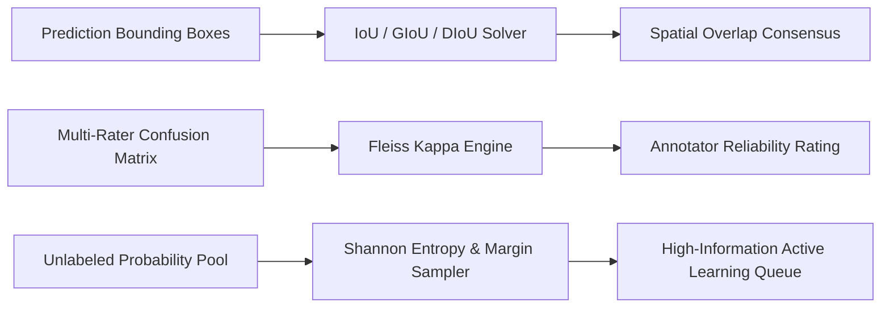

# genpark-auto-annotator


GenPark Auto Annotator is a zero-dependency machine learning data labeling and QA engine implementing spatial bounding box geometric metrics (IoU, GIoU, DIoU), multi-annotator consensus validation via Fleiss' Kappa, and pool-based active learning uncertainty acquisition algorithms.



## Features
- **Spatial IoU / GIoU / DIoU Geometry**: Calculates overlap area, smallest enclosing convex bounding box, and normalized center distance penalty.
- **Fleiss' Kappa Consensus**: Evaluates categorical agreement across arbitrary numbers of raters and categories with Landis-Koch thresholds.
- **Active Learning Acquisition**: Identifies maximum uncertainty samples using Shannon Entropy, Margin Sampling, and Least Confidence to minimize annotation costs.

## Quickstart

```python
from client import GenParkAutoAnnotator

annotator = GenParkAutoAnnotator()
res = annotator.calculate_bbox_iou_and_giou(
    {"x1": 10, "y1": 10, "x2": 50, "y2": 50},
    {"x1": 20, "y1": 20, "x2": 60, "y2": 60}
)
print("IoU:", res["iou"], "GIoU:", res["giou"])
```

## License
MIT
